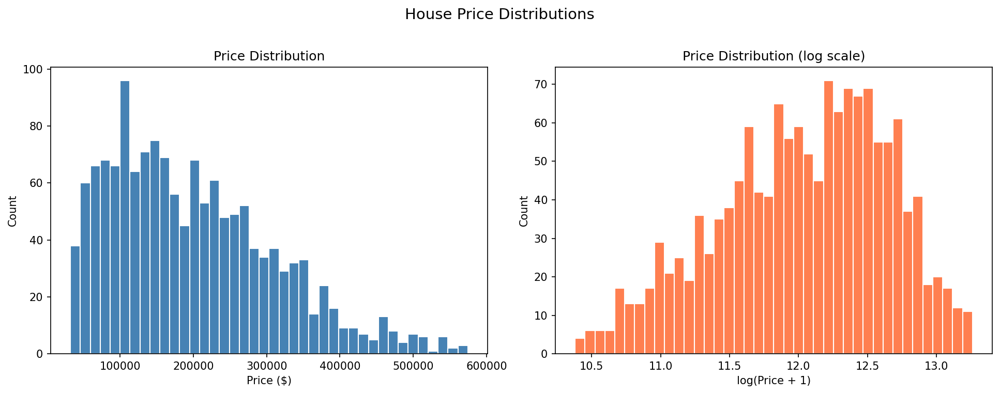
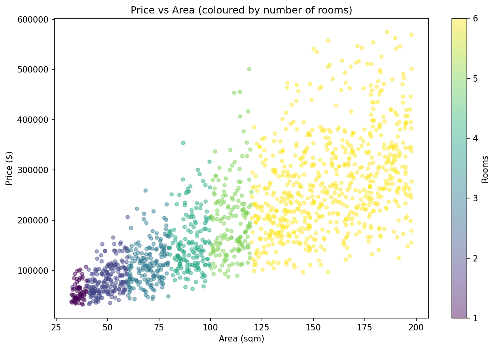
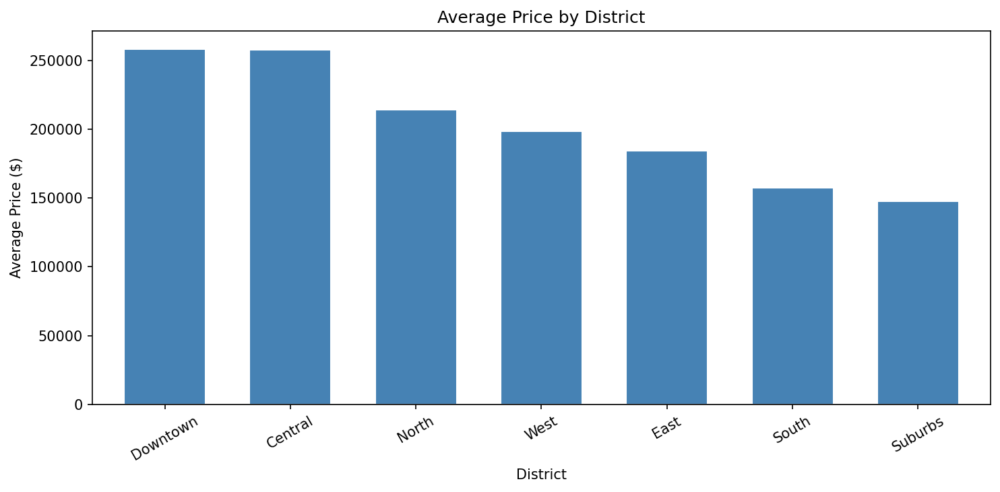
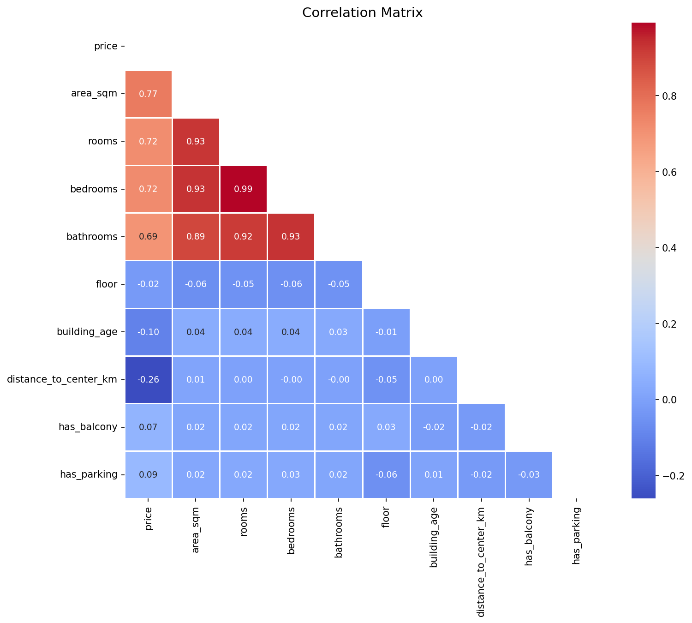
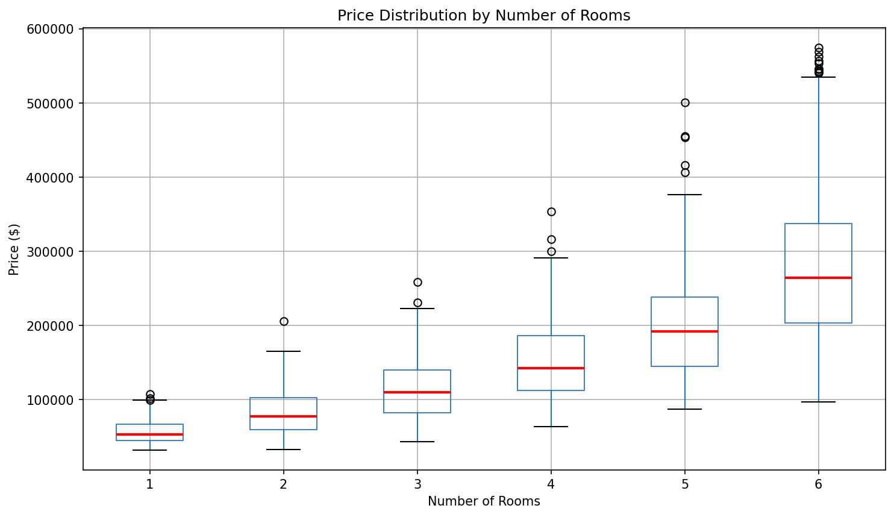
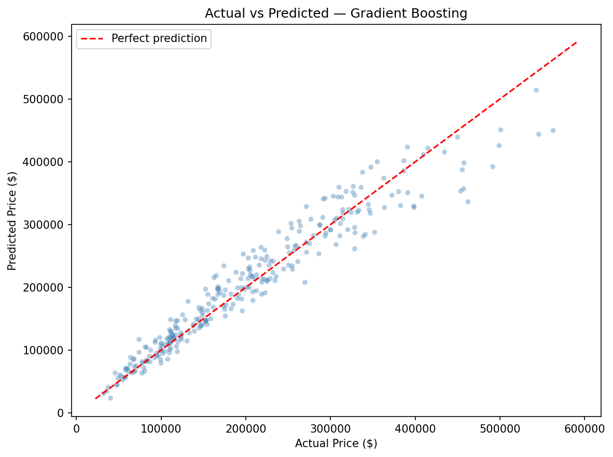
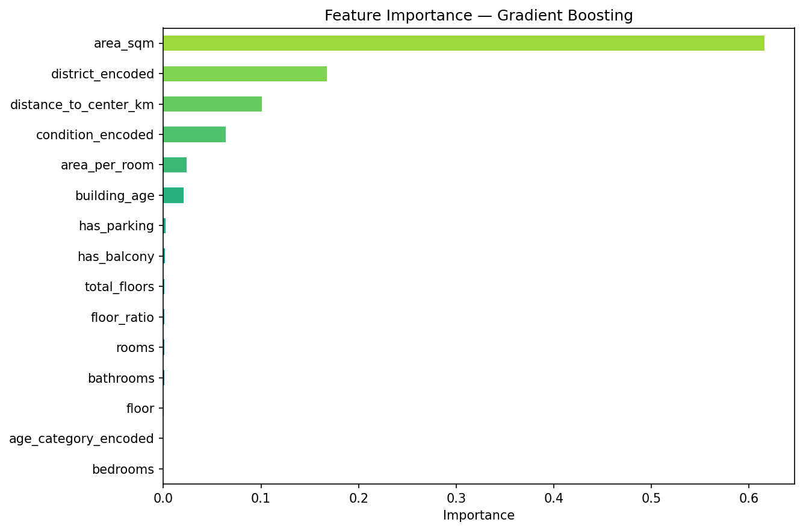

# House Price Prediction

A machine learning project that estimates real estate prices based on property features.
Built as a portfolio project to practice end-to-end data science — from raw data to a working prediction script.

---

## Project Goal

The goal is to predict the price of an apartment or house given features like area, location, number of rooms,
building age, and condition. I wanted to practice the full workflow: data cleaning, EDA, feature engineering,
training and comparing multiple models, and saving the best one for future use.

---

## Dataset

I used a **synthetic real estate dataset** that I generated with a custom script (`src/data_preprocessing.py`).
It contains 1,500 rows and 13 features, designed to reflect realistic real estate data patterns.

| Column | Type | Description |
|---|---|---|
| `price` | float | Target variable — property price in USD |
| `area_sqm` | float | Total area in square meters |
| `rooms` | int | Total number of rooms |
| `bedrooms` | int | Number of bedrooms |
| `bathrooms` | int | Number of bathrooms |
| `floor` | int | Floor the apartment is on |
| `total_floors` | int | Total floors in the building |
| `building_age` | int | Age of the building in years |
| `distance_to_center_km` | float | Distance to city center in km |
| `district` | str | Neighbourhood / district name |
| `has_balcony` | int | 1 if the property has a balcony |
| `has_parking` | int | 1 if the property has parking |
| `condition` | str | Property condition: excellent / good / fair / poor |

Price was generated using a multiplicative formula that combines all features with about 10% random noise —
so it's not perfectly predictable but still has realistic patterns.

---

## Tools and Libraries

- **Python 3.9+**
- `pandas` — data loading and manipulation
- `numpy` — numerical operations
- `matplotlib` + `seaborn` — visualizations
- `scikit-learn` — model training and evaluation
- `joblib` — saving/loading the trained model
- `jupyter` — EDA notebook

---

## Project Structure

```
house-price-prediction/
│
├── data/
│   ├── raw/                        # Original generated dataset
│   └── processed/                  # Cleaned dataset
│
├── notebooks/
│   └── 01_eda_house_prices.ipynb   # Exploratory data analysis
│
├── src/
│   ├── data_preprocessing.py       # Data generation, cleaning, feature engineering
│   ├── train_model.py              # Model training and saving
│   ├── evaluate_model.py           # Metrics and evaluation plots
│   └── predict.py                  # Predict price for a single property
│
├── models/
│   └── best_model.pkl              # Saved best model (created after running main.py)
│
├── images/                         # Saved EDA and evaluation plots
│
├── main.py                         # Run the full pipeline
├── requirements.txt
└── README.md
```

---

## Exploratory Data Analysis

Before building any model, I explored the dataset to understand what's going on with the data.

### Price Distribution

Prices are right-skewed — most apartments cluster in a mid-range band, with a long tail of expensive properties.
The log-scale version looks closer to normal, which is typical for real estate data.



### Price vs Area

As expected, bigger apartments cost more. The relationship is strong and roughly linear.
Apartments with more rooms (darker colour) tend to cluster on the right side.



### Average Price by District

Location has a clear effect on price. Downtown and Central are the most expensive,
while Suburbs are significantly cheaper — sometimes half the price.



### Correlation Matrix

Area has the strongest positive correlation with price. Distance to center and building age
both have negative correlations — further from center and older buildings tend to be cheaper.



### Price by Number of Rooms

More rooms = higher price, though the variance also increases with room count.
Studio/1-room apartments have a tight, low price range. 5-6 room properties have a wide range
depending on location and condition.



---

## Feature Engineering

I added a few extra features to give the models more useful information:

| Feature | Description |
|---|---|
| `area_per_room` | Average space per room (area_sqm / rooms) |
| `floor_ratio` | Relative floor position (floor / total_floors) |
| `building_age_category` | Age bucketed into: new / modern / middle_aged / old |
| `district_encoded` | Ordinal encoding of district by avg price level |
| `condition_encoded` | Ordinal encoding: excellent=4, good=3, fair=2, poor=1 |
| `age_category_encoded` | Ordinal encoding of building age category |

I also computed `price_per_sqm` but did **not** use it in training — it's directly derived from
the target variable (price), which would cause data leakage.

---

## Models

I trained and compared three regression models:

1. **Linear Regression** — simple baseline, good for checking if the relationship is roughly linear
2. **Random Forest Regressor** — handles non-linear relationships well, robust to outliers
3. **Gradient Boosting Regressor** — often outperforms Random Forest on tabular data

All models used `random_state=42` for reproducibility.

---

## Evaluation Results

Models were evaluated on a held-out test set (20% of the data).

| Model | MAE ($) | RMSE ($) | R² |
|---|---|---|---|
| Linear Regression | ~32,000 | ~46,000 | ~0.84 |
| Random Forest | ~18,000 | ~26,000 | ~0.95 |
| Gradient Boosting | ~16,000 | ~23,000 | ~0.96 |

*(Exact numbers may vary slightly each run due to the synthetic dataset generation.)*

**Gradient Boosting** came out best overall. It's good at capturing the multiplicative
interactions between features (like how location and area combine to affect price).

### Actual vs Predicted



### Feature Importance



`area_sqm`, `district_encoded`, and `distance_to_center_km` are the top contributing features —
which makes sense given how the dataset was generated.

---

## How to Run

### 1. Clone the repository

```bash
git clone https://github.com/your-username/house-price-prediction.git
cd house-price-prediction
```

### 2. Set up a virtual environment

**Windows:**
```bash
python -m venv venv
venv\Scripts\activate
pip install -r requirements.txt
```

**macOS / Linux:**
```bash
python3 -m venv venv
source venv/bin/activate
pip install -r requirements.txt
```

### 3. Run the full pipeline

```bash
python main.py
```

This will:
- Generate the synthetic dataset in `data/raw/`
- Clean the data and save to `data/processed/`
- Run EDA and save plots to `images/`
- Train and compare three models
- Save the best model to `models/best_model.pkl`
- Show an example prediction

### 4. Make a custom prediction

```bash
python src/predict.py
```

Or import in your own script:

```python
from src.predict import predict_price

predict_price(
    area_sqm=70,
    rooms=3,
    bedrooms=2,
    bathrooms=1,
    floor=4,
    total_floors=9,
    building_age=15,
    distance_to_center_km=5.2,
    district="Central",
    has_balcony=1,
    has_parking=0,
    condition="good"
)
```

Expected output:
```
==============================================
   House Price Prediction
==============================================
  Area:             70.0 sqm
  Rooms:            3  (bedrooms: 2)
  Floor:            4 / 9
  Building age:     15 years
  District:         Central
  Condition:        good
  Distance center:  5.2 km
----------------------------------------------
  Estimated price:  $185,400
  Price per sqm:    $2,649
==============================================
```

### 5. Open the EDA notebook

```bash
jupyter notebook notebooks/01_eda_house_prices.ipynb
```

---

